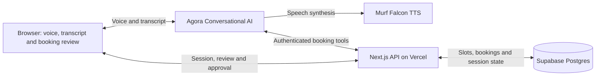

# Demo Care Clinic — Voice AI Appointment Booking

Find an available doctor appointment through conversation, review the details,
and explicitly approve the booking before it is saved.

Built for **From Conversations to Autonomous Action**, this full-stack voice AI
prototype connects natural conversation to scheduling tools and persistent
booking storage. The clinic and patient aliases are fictional; availability
and confirmed bookings are backed by the application's database.

**[Try the live demo](https://demo-care-clinic.vercel.app)**

## Screenshots

### Start a conversation


### From conversation to a saved booking


## Features

- **Natural voice interaction:** Agora Conversational AI with Murf Falcon TTS,
  using the Anisha voice.
- **Availability checks:** checks the configured doctor's schedule and existing
  bookings, offering actual alternatives when a requested time is unavailable.
- **Live transcripts:** follow both sides of the conversation on screen.
- **Explicit approval:** review appointment details and approve on screen.
  A spoken “yes” alone never saves a booking.
- **Persistent confirmation:** saves the approved appointment and displays a
  server-confirmed booking card with a reference.
- **Booking safeguards:** validates session ownership and approval, handles
  retries, and uses database constraints to prevent double booking.
- **Emergency redirection:** stops routine booking for supported emergency
  phrases and directs the user toward urgent help.

## Booking flow

1. Start a conversation and allow microphone access.
2. Describe a routine concern and request an appointment.
3. Choose from the available slots returned by the scheduling tools.
4. Review the doctor, date, time and demo patient alias on screen.
5. Approve the booking and receive the saved confirmation reference.

The fictional directory contains **Dr. Ramesh**, a general physician offering
30-minute appointments on Monday, Tuesday, Thursday and Friday, 17:00–20:00
**Asia/Kolkata**. The booking window covers today through the next six local
calendar days, excluding past starts and already-booked slots.

## Technology

| Layer | Technology |
| --- | --- |
| Application | Next.js 16, React 19, TypeScript, Tailwind CSS |
| Voice and messaging | Agora Conversational AI, RTC and RTM |
| Speech recognition | Agora-managed Deepgram nova-3 |
| Language model | Agora-managed OpenAI gpt-4o-mini |
| Speech synthesis | Murf Falcon, Anisha, en-IN |
| Deployed storage | Supabase Postgres |
| Hosting | Vercel |
| Local demo storage | Node.js built-in SQLite |

## Architecture



Agora handles the conversation using managed speech recognition and language
model services, with Murf generating the assistant's speech. The agent calls
server-side tools to look up doctors, check availability and prepare a booking
for review. The browser submits explicit approval to the Next.js API; the
server validates it and commits the booking before returning confirmation.

## Engineering decisions

### Keep approval outside the language model

The agent can propose an appointment, but it cannot authorize saving one.
Approval is bound to a specific selection and session, expires after two
minutes, and is invalidated when new user speech is observed. This adds an
on-screen step to the voice flow so a spoken response or model-generated flag
cannot independently authorize a database write.

### Persist session authority alongside bookings

Vercel requests can run in different application instances, so process-local
approval state cannot coordinate the deployed flow. Postgres stores session
ownership, pending review, expiry and emergency-stop state alongside slots and
bookings. This requires database access for session checks, but keeps authority
consistent across instances. SQLite remains available for a single-process
local demo.

### Commit once, then confirm

The server locks the session and slot during the booking transaction, validates
the approval and uses a unique slot constraint as the final double-booking
guard. Idempotency checks recognize retries without creating another booking.
The booking and saved session metadata commit together before confirmation is
attempted. If confirmation speech fails, the committed appointment remains
saved; speech delivery and database persistence are separate outcomes.

## Development

The application lives in [`baseline/`](baseline/). Use **Node.js 24.10+** and
**pnpm**, then run:

```powershell
cd baseline
pnpm install
```

Copy `env.local.example` to `.env.local` if it does not already exist and
configure the Agora and Murf credentials. Never commit provider credentials.
See the [application guide](baseline/README.md) for local setup and the
booking gateway. Agora's cloud requires a reachable HTTPS tool endpoint;
local voice development uses a tools-only tunnel.

```powershell
pnpm run dev
```

Open [localhost:3000](http://localhost:3000).

For Postgres-backed development, configure server-only `DATABASE_URL` and
`BOOKING_APPROVAL_SECRET` values. Without `DATABASE_URL`, local development uses
SQLite and process-local session authority; deployed operation requires Postgres.

For hosted operation, set `BOOKING_APP_ORIGIN` and `BOOKING_TOOLS_BASE_URL` to
the deployed HTTPS origin without a trailing slash, and enable
`BOOKING_PUBLIC_DEMO` to permit demo startup. See the
[environment template](baseline/env.local.example) for the configuration names
and the [application guide](baseline/README.md) for operational details.

## Verification

Run from `baseline/`:

```powershell
pnpm run verify:booking
pnpm run verify:voice
pnpm run verify
```

`pnpm run verify:postgres` is an opt-in integration check requiring a configured
demo database. It creates
synthetic records and removes its own records afterward.

Automated checks cover booking and session boundaries. Audible voice delivery
and the complete conversation flow also require a live browser session.

## Demo scope

This is a scheduling prototype for fictional appointments. It does not diagnose,
provide medical advice or connect to a real clinic calendar. Only **Demo Patient**
and **Demo Guest** aliases are supported. Emergency phrase handling is
conservative redirection, not medical triage.

The public demo has startup and session limits; new conversations may be
unavailable temporarily when those limits are reached.

## References and attribution

- [Application setup and verification](baseline/README.md)
- [Original local booking contract](baseline/docs/booking-contract.md)
- [Voice-to-action implementation](baseline/docs/voice-to-action.md)

Based on the MIT-licensed
[official Agora Next.js quickstart](https://github.com/AgoraIO-Conversational-AI/agent-quickstart-nextjs).
Scenario inspiration:
[Agora clinic appointment assistant demo](https://github.com/AgoraIO-Community/agora-clinic-appointment-assistant-demo).
Availability lookup, approval and booking persistence are implemented in this fork.
Original attribution is preserved in [the application license](baseline/LICENSE).
